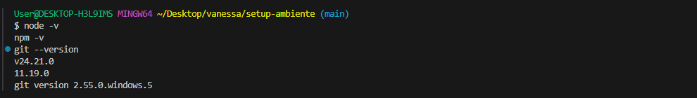
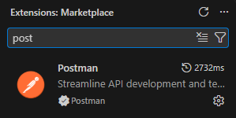

# SETUP-AMBIENTE

Repositório criado para documentar as instalações do meu ambiente de aprendizado em Node.js, Git e VS Code.
Também conta com 3 exercícios de lógica de programação com JavaScript.

## Ferramentas Instaladas
- **Node.js**: v24.21.0
- **npm**: 11.19.0
- **Git**: git version 2.55.0.windows.5

### Comprovante no terminal:

### -Extensões do VS code:

## Exercícios de Lógica (JavaScript)

1. **Exercício 1: Par ou Ímpar**
   - Criar uma função que receba um número e verifique se ele é par ou ímpar.
   - exercício: [Exercicio 1](desafio1.js)
2. **Exercício 2: Tabuada de um número**
   - Receber um número de 1 a 10 e imprimir a sua tabuada de 1 a 10.
   - exercício: [Exercicio 2](desafio2.js)
3. **Exercício 3: Maior número**
   - Percorrer um array de números inteiros e retornar o maior valor encontrado.
   - exercício: [Exercicio 3](desafio3.js)